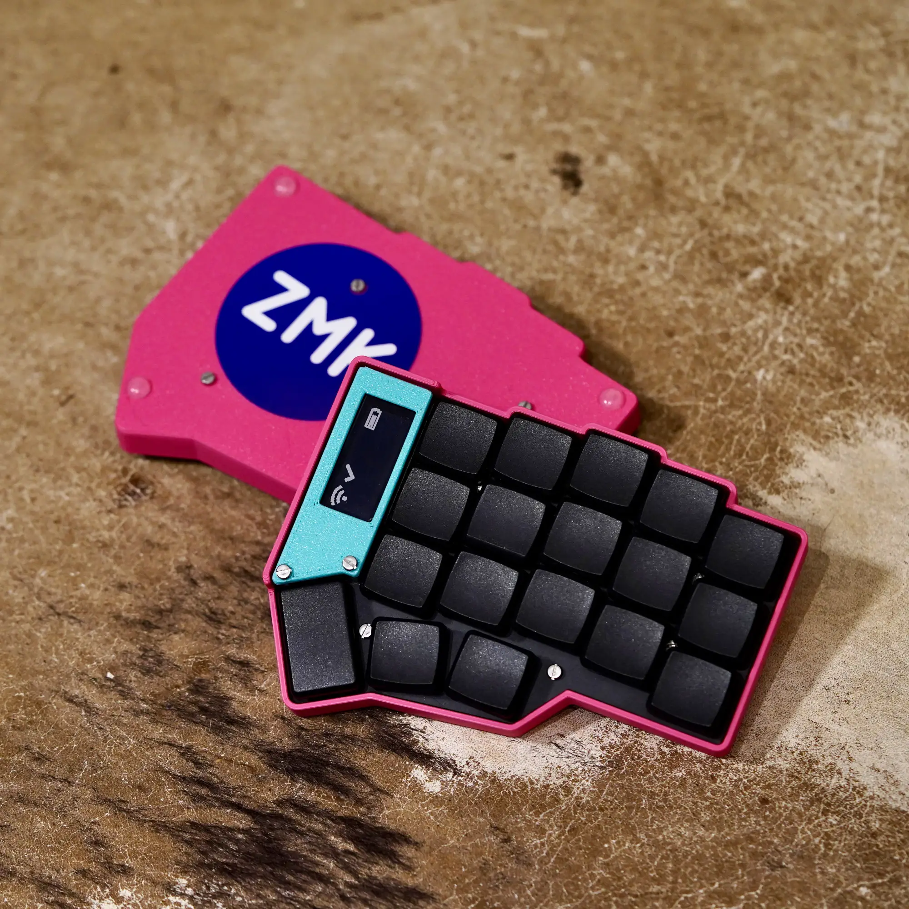
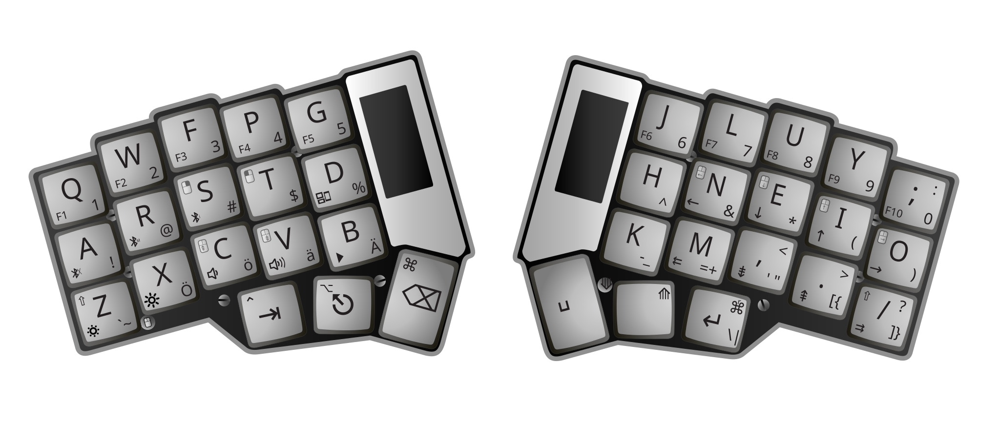

# Corne keyboard


## Config


On the Typing layer, tap **Q** to type Q or hold it for **Apple Globe** (300 ms,
balanced hold-tap). Hold Q while pressing another key for iPad Globe shortcuts.
Globe+Q requires a separate Q binding and is not available with this placement.

## Kit
[Parts or pre-built](https://typeractive.xyz/pages/build)

## Utility displays and key lookup

Both screens show their own half of the active keymap, including the three
thumb keys. The four layers are **Typing**, **Navigate** (cursor, mouse and
windows), **Symbols** (numbers and punctuation), and **System** (devices,
function keys, brightness and media). A small `^` beneath a key marks a hold-tap;
the thumb cells spell out their hold action. Typing speed and decorative art
are removed.

Battery percentage and connection status stay visible. The left screen names
the selected Bluetooth profile, or says `USB output` when USB is actually in use.
The right screen shows held Ctrl/Shift/Alt/Cmd modifiers and the split link.
`BT+` means connected, `BT-` means paired but disconnected, and `PAIR` means the
selected profile is unpaired. A `+` immediately after the battery percentage
means USB power is present; it does not distinguish charging from a full battery.
If synchronization is lost, the right screen marks the map unknown.

| Profile | Device | Display name |
| --- | --- | --- |
| 1 | 14-inch MacBook Pro | `MBP 14"` |
| 2 | Vision Pro | `Vision Pro` |
| 3 | iPhone | `iPhone` |
| 4 | iPad Pro | `iPad Pro` |
| 5 | 16-inch MacBook Pro | `MBP 16"` |

These are display aliases; the existing slots, pairings and device-selection
keys keep their meaning.

To look up a key:

1. Hold **Space** until **Navigate** is active, then tap **G** and release both.
2. In **LOOKUP**, press any key. The left screen shows an enlarged key reference;
   the right spells out its actions on all four layers, including tap and hold.
   `=` beside a layer name means that key inherits its Typing-layer action.
3. Hold the physical **Space/Nav + G** keys together again, then release all
   keys to resume typing.

Lookup stays open after releasing its entry keys, so all 36 physical keys can
be inspected, including Escape and the thumbs. Inspection sends no key, mouse,
macro, Bluetooth or output action. Existing held keys release normally before
lookup becomes active. The only newly assigned action is the previously unused
G position on Navigate. The existing Space/Nav + Symbols System combo and all
hold-tap timings remain unchanged outside lookup.

The enlarged reference uses the readable pixel-label fallback inspired by
`layout.svg`, with no key frame. A native-resolution SVG trial retained the
large letters but lost detail in the smallest action icons. The named text on
the opposite screen is authoritative. Normal-map abbreviations include `M` for
pointer movement, `S` for scrolling, `K*` for keypad multiply, and `a:`/`o:` versus
`A:`/`O:` for lower/uppercase umlaut macros; lookup spells these out.

## Firmware version

Official ZMK `main`, pinned at
[`4dd95d7840eb3d5a3f59bb29fbf1ab054715ef85`](https://github.com/zmkfirmware/zmk/commit/4dd95d7840eb3d5a3f59bb29fbf1ab054715ef85),
the latest upstream commit checked on 2026-10-25. This is the development branch
with Zephyr 4.1; the latest tagged stable release at that time is v0.3.0.

The upgrade from `urob/mouse-3.2` preserves all 42 positions on all four layers,
the system-layer combo, umlaut macros, Bluetooth profile keys, and mouse
directions and speeds. The custom hold-taps retain their balanced flavor,
300 ms tapping term, and zero quick-tap period. The deprecated
`global-quick-tap` with a zero period becomes the equivalent
`require-prior-idle-ms = <0>`.

Mouse support uses the current `CONFIG_ZMK_POINTING`, `pointing.h`, and `&msc`
names. The hardware target is now `nice_nano@2.0.0//zmk`, with the same Corne
and nice!view shields. See the [ZMK migration guide](https://zmk.dev/blog/2025/12/09/zephyr-4-1)
and [mouse documentation](https://zmk.dev/docs/keymaps/behaviors/mouse-emulation).

## Local build

The local build has been verified on an Apple Silicon Mac. It requires Git,
Docker Desktop with its engine running, internet access, and several GB of free
disk space for the build image and dependencies. Python, CMake, West, and the
Zephyr SDK run inside the pinned Docker image; no host toolchain installation is
needed.

For a fresh checkout:

```sh
git clone https://github.com/jojule/corne-wireless-zmk-config.git
cd corne-wireless-zmk-config
```

From the repository directory, check that Docker is available and compile:

```sh
docker info
./scripts/build-local.sh
```

If `docker info` cannot connect to the daemon, start Docker Desktop and wait for
its engine to be ready before running the build script.

This downloads the pinned official build image and ZMK sources, then compiles both
halves locally. Every run requires network access; subsequent runs reuse
downloaded repositories. Build tools and caches stay in Docker and `.local-build/`;
no host Python packages are installed.
ZMK's imported Zephyr branch can advance between builds; the generated frozen
manifest records the exact dependency commits used for each build.

Outputs:

- `firmware/corne_left.uf2`
- `firmware/corne_right.uf2`
- `firmware/SHA256SUMS`, the frozen dependency manifest, and a config snapshot
- `firmware/utility-source/` and `firmware/source-SHA256SUMS` for the custom display code
- `.local-build/build.log` and per-half build directories

Both output directories are ignored by Git. The script reads the targets from
`build.yaml` and rebuilds each half from a clean build directory. After editing
`config/corne.keymap` or `config/corne.conf`, rerun the same command. Check that the
script exits successfully before using the outputs; a failed run can leave UF2
files from an earlier successful build.

The build also runs the utility tests inside Docker, including lookup entry,
captured-event replay, exit/release routing, wire-format checks, legend drift,
and rendering. The same tests can be run with `bash scripts/test-utility.sh`
on a host with Python 3 and a C compiler after the ZMK sources have been fetched.

If you edit the original four layers, regenerate their display descriptions:

```sh
python3 scripts/generate-display-data.py
```

The generator uses only the Python standard library. Both the local build and
GitHub's CMake build refuse stale descriptions or unsupported new bindings.
Teach the generator any new behavior before building. The firmware uses the
repository's Zephyr module automatically on GitHub and via `ZMK_EXTRA_MODULES`
in the local build; do not copy custom code into the downloaded ZMK source tree.

To verify the generated firmware checksums on macOS:

```sh
(cd firmware && shasum -a 256 -c SHA256SUMS)
```

## Flash and check

Connect a half by USB and double-tap its reset button to open its UF2 bootloader
drive. Copy the matching left or right UF2 onto that drive, then repeat for the
other half. Update both halves together.

After flashing, check ordinary typing, Z/Shift and the other hold-taps, layers,
the two-thumb system-layer combo, umlaut macros, mouse movement/scrolling/clicks,
and Bluetooth. Also check lookup on both halves, including thumb keys and
Bluetooth-clear/macro keys (inspection must do nothing on the host), release
all keys when exiting, and verify typing resumes without a stuck modifier.
Power-cycle the right half and confirm its layer/lookup view synchronizes again.
If Bluetooth mouse or keyboard reports stop working after the
upgrade, remove the host pairing, clear that keyboard profile using the existing
`BT_CLR` key, and pair again; upstream HID reports have changed since the old fork.

The intermittent Z/Shift and duplicate-letter problems were resolved by replacing
the affected switches after this upgrade. No debounce or hold-tap timing change
was needed. If similar symptoms return, check the switches and socket contacts
before changing hold-tap timing. See [ZMK debouncing](https://zmk.dev/docs/features/debouncing).
